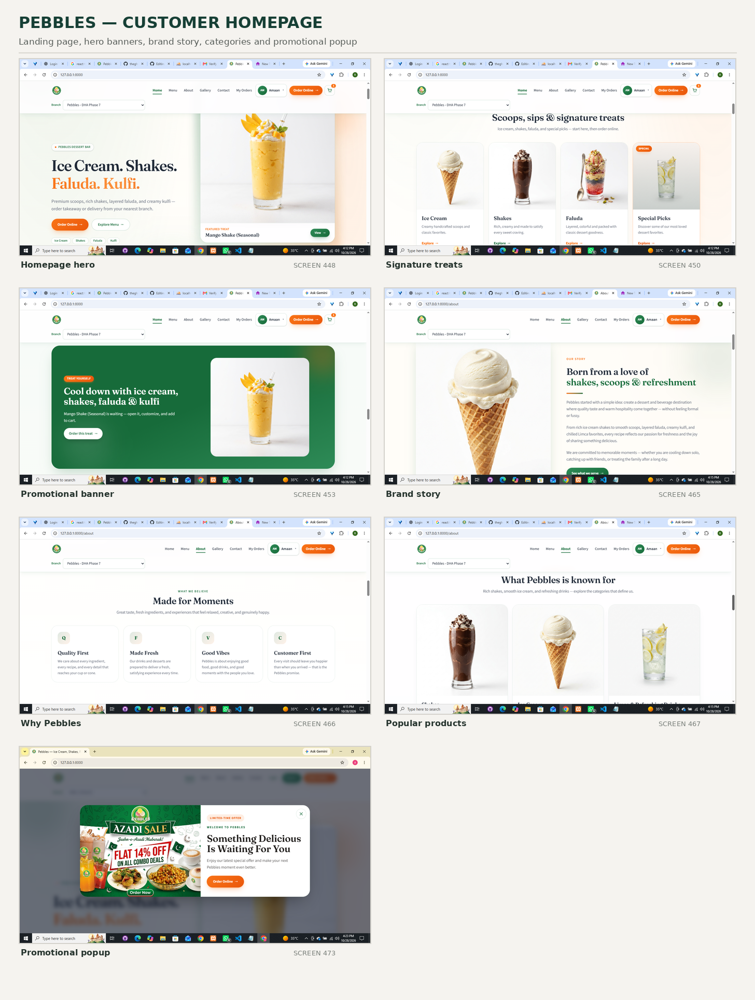
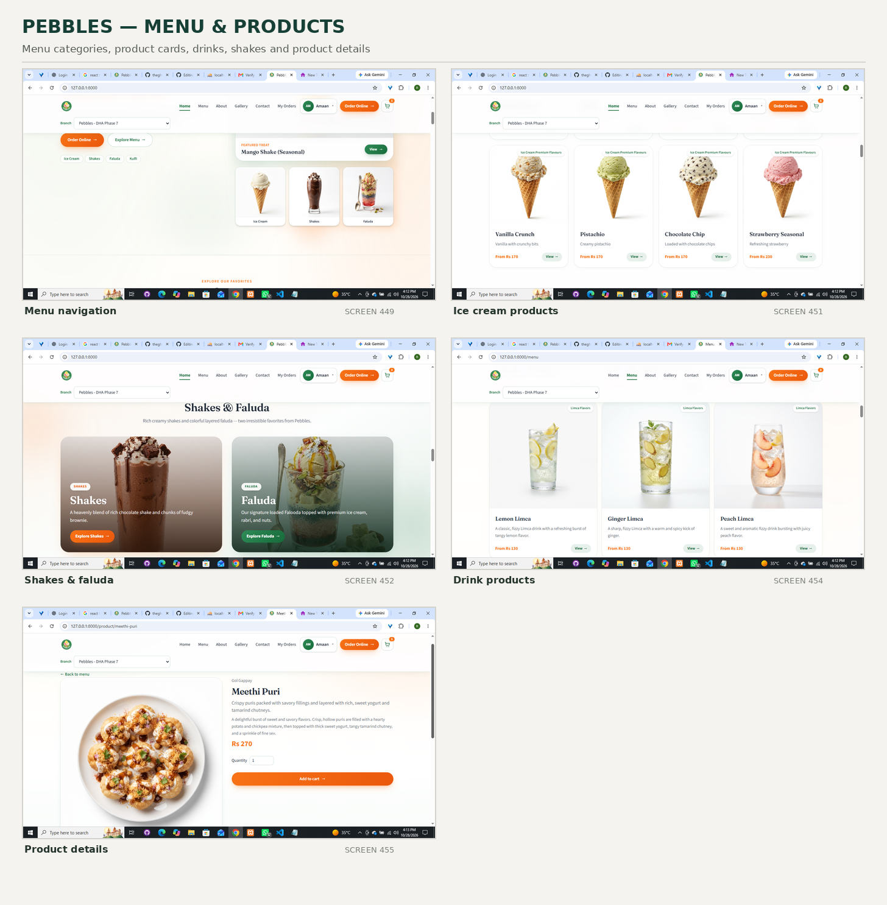
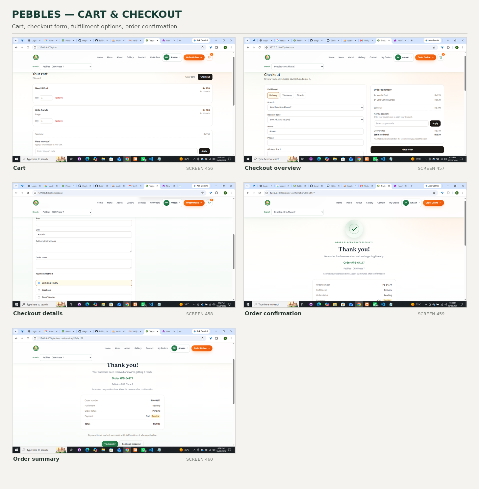
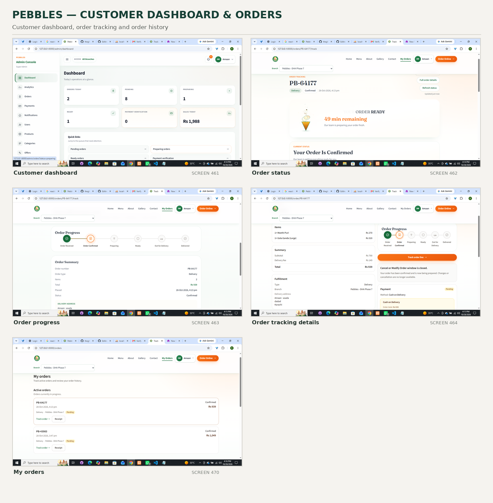
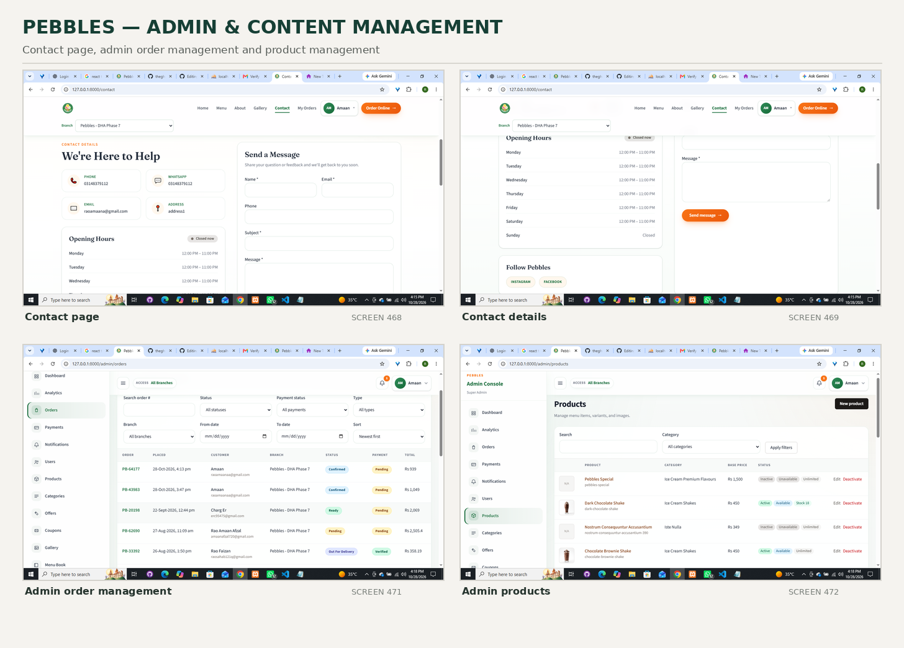

# Pebbles

Food-ordering platform foundation (Laravel 12 API + React SPA + Sanctum).

## Stack

- **Backend:** Laravel 12, PHP 8.2+, MySQL, Laravel Sanctum (first-party SPA cookie/session auth)
- **Frontend:** React 19, React Router, Axios, Tailwind CSS v4 (CSS-first), Vite 7
- **Roles:** `user`, `superadmin` (`App\Enums\UserRole`)
- **Auth:** Session cookies via Sanctum stateful API (not token-first for the SPA)

## Architecture

### Backend

- API routes live in `routes/api.php` and are registered from `bootstrap/app.php`.
- Sanctum SPA mode is enabled with `$middleware->statefulApi()`.
- Auth endpoints: `POST /api/register`, `POST /api/login`, `POST /api/logout`, `GET /api/user`.
- Email verification: signed `GET /api/email/verify/{id}/{hash}` and `POST /api/email/verification-notification`.
- Role gate: `access-admin` / `role`; middleware alias `role:superadmin`.
- Customer accounts use `MustVerifyEmail`. New registrations always receive the `user` role.

### Frontend

- SPA shell: `resources/views/app.blade.php` + catch-all in `routes/web.php`.
- Entry: `resources/js/main.jsx`.
- Infra: `resources/js/api/client.js`, `api/config.js`, `api/catalog.js`, `contexts/AuthContext.jsx`, `lib/errors.js`.
- Router root: `resources/js/Application.jsx` (avoids Windows case clashes with `app.jsx`).
- Customer storefront routes: `/`, `/menu`, `/menu/:categorySlug`, `/product/:slug` (browse only; no cart/checkout).

### Authentication flow (SPA)

1. `GET /sanctum/csrf-cookie`
2. `POST /api/login` or `POST /api/register` (web middleware — establishes session cookies)
3. Authenticated API calls use session cookie + `X-XSRF-TOKEN` against `/api/*` (`auth:sanctum`)
4. `POST /api/logout` destroys the session
5. Axios is configured with `withCredentials` and `withXSRFToken`

## Local development

```bash
composer install
cp .env.example .env   # if needed
php artisan key:generate
# Create MySQL database `pebbles`, then:
php artisan migrate
npm install
composer run dev
# or separately:
# php artisan serve
# npm run dev
```

Tests use in-memory SQLite (`phpunit.xml`) and do not require MySQL.

```bash
php artisan test --compact
npm run build
vendor/bin/pint --dirty
```

## Environment variables

| Variable | Purpose |
|---|---|
| `APP_URL` | Laravel origin (e.g. `http://localhost:8000`) |
| `FRONTEND_URL` | React/Vite origin for CORS (e.g. `http://localhost:5173`) |
| `DB_*` | MySQL connection (`DB_CONNECTION=mysql`) |
| `SANCTUM_STATEFUL_DOMAINS` | Domains allowed to use cookie auth |
| `VITE_APP_NAME` | Frontend display name |
| `VITE_API_BASE_URL` | Optional API origin; leave blank for same-origin SPA |
| `ORDER_CANCELLATION_MINUTES` | Fallback cancellation window (default 30; settings table overrides) |
| `PAYMENT_PROOF_DISK` | Disk for payment proofs (default `local` / private) |

## Role architecture

- Stored on `users.role` as a string backed by `App\Enums\UserRole`.
- Defaults to `user`.
- Promote superadmins via seeder/tinker only (registration never assigns `superadmin`).
- Protect admin routes with `middleware('role:superadmin')` or `Gate::authorize('access-admin')`.

## Phase 2 — Domain architecture

Backend domain foundation only. **No customer/admin UI.** Frontend never becomes the source of truth for prices or order totals.

### Database setup

```bash
# MySQL database `pebbles` must exist
php artisan migrate:fresh --seed
```

### Core domains

| Domain | Tables |
|---|---|
| Settings | `settings` (`order_cancellation_minutes`) |
| Catalog | `categories`, `products`, `product_images`, `product_variants`, `add_on_groups`, `add_ons`, pivot |
| Branches / delivery | `branches`, `delivery_zones` |
| Customers | `addresses` |
| Cart | `carts`, `cart_items`, `cart_item_add_ons` |
| Orders | `orders`, `order_items`, `order_item_add_ons`, `order_status_histories` |
| Payments | `payments`, `payment_proofs` (private disk) |
| CMS | `banners`, `site_contents` |

### Important relationships

- `Category` → products; `Product` → images, variants, add-on groups
- `Branch` → delivery zones, orders
- `User` → addresses, cart, orders
- `Order` → items (+ historical add-ons), payment, status histories
- Orders use `public_order_number` (`PB-#####`) for customer-facing lookup (`GET /api/orders/{public_order_number}`)

### Order / payment / delivery rules

- Order types: `delivery`, `takeaway`, `dine_in`
- Statuses: pending → confirmed → preparing → ready → out_for_delivery → completed / cancelled
- Historical snapshots store product/variant/add-on names and prices on order lines
- Delivery fee and zone name are snapshotted on the order
- Payment methods: COD, EasyPaisa, JazzCash, Bank Transfer (data model only)
- Payment proofs use disk `local` → `storage/app/private/payment-proofs/`

### Seed data

- Superadmin: `superadmin@pebbles.test` / `password`
- Customers: `ayesha@example.com`, `bilal@example.com`, `sara@example.com` / `password`
- Branch: **Pebbles - DHA Phase 7**
- Sample categories, products, variants, extras add-ons, zones, banners, site content

### Testing

```bash
php artisan test --compact
```

## Phase 3 — Catalog API + customer storefront

Public, read-only catalog browsing on top of Phase 2 models. **No cart, checkout, payments, or admin CMS UI.**

### Public Catalog API

All endpoints are unauthenticated under `/api/v1/catalog`:

| Method | Path | Notes |
|---|---|---|
| `GET` | `/api/v1/catalog/categories` | Active categories only, ordered by `sort_order` |
| `GET` | `/api/v1/catalog/products` | Query: `category={slug}`, `search={q}`, `featured=1` |
| `GET` | `/api/v1/catalog/products/{slug}` | Detail with images, active variants, add-on groups → options |
| `GET` | `/api/v1/catalog/branches` | Active branches |
| `GET` | `/api/v1/catalog/delivery-zones` | Query: `branch={slug}`; includes read-only fee / min order |

**Visibility**

- Soft-deleted and `is_active = false` records are hidden.
- Products also require an active category; listing/detail use the `catalog` query scopes.
- Product `available` comes from `is_available` (unavailable products can still appear, flagged as not available).
- Invalid `category` or `branch` filters return **422** validation errors.
- Missing or inactive product slugs return **404**.

**Pricing / media**

- Listings expose `starting_price` = minimum active variant price, else `base_price` (server-computed).
- Image URLs use the public disk (`Storage::disk('public')->url(...)`). Run `php artisan storage:link` when real files exist under `storage/app/public`.

### Storefront UI

- React pages load catalog data via `resources/js/api/catalog.js` (Axios).
- Branch selector stores `{ id, name, slug }` in `localStorage` only — it does **not** filter products in Phase 3.
- Product detail keeps variant/add-on choices as local UI state; Phase 4 enables Add to cart against the authenticated cart API.

## Phase 4 — Cart + Checkout + Order Creation

Authenticated customers can configure products, manage a cart, and place orders. **The client is never authoritative for prices or totals.** Payment method selection, proof upload, and order tracking are covered in Phase 5.

### Cart & checkout API (auth:sanctum)

| Method | Path | Notes |
|---|---|---|
| `GET` | `/api/v1/cart` | Current user’s cart with authoritative line prices / totals |
| `POST` | `/api/v1/cart/items` | Add configuration (`product_id`, optional `product_variant_id`, `add_on_ids`, `quantity` 1–99) |
| `PATCH` | `/api/v1/cart/items/{item}` | Update quantity only (revalidates availability/pricing) |
| `DELETE` | `/api/v1/cart/items/{item}` | Remove one owned cart item |
| `DELETE` | `/api/v1/cart` | Clear cart items (cart row remains) |
| `POST` | `/api/v1/checkout` | Revalidate cart + create order transactionally |

**Pricing authority**

- Client-supplied `price`, `subtotal`, `total`, `delivery_fee`, and `items` on checkout are ignored/stripped.
- Unit and line prices are resolved from live catalog data (`ResolveCartPricing`).
- Variants and add-ons must belong to the selected product; foreign IDs return **422**.
- Products must be catalog-visible and `is_available`; inactive variants/add-ons are rejected.
- Cart `delivery_fee` is `0.00` until checkout; delivery fee comes from the selected zone at checkout.

**Fulfillment (`type`)**

- `delivery` — requires active `branch_id`, zone for that branch, and either `address_id` (owned) or inline delivery fields (`delivery_recipient_name`, `delivery_phone`, `delivery_line1`, `delivery_city`, …). Applies zone `delivery_fee` and enforces `minimum_order_amount`.
- `takeaway` — requires active branch; optional `pickup_notes`.
- `dine_in` — requires active branch and `table_number`.

**Order creation**

- Runs in a DB transaction with cart `lockForUpdate`.
- Creates `Order` (`public_order_number` via `OrderNumberGenerator`), snapshotted `OrderItem` / `OrderItemAddOn`, initial `OrderStatusHistory`, and a **pending** `Payment` (default method `cod`).
- Clears cart items after success. A second checkout with an empty cart fails cleanly (**422**).
- Checkout response exposes `order_number` (not internal numeric `id`), `status`, `fulfillment_type`, money fields, item snapshots, and a compact `payment` summary.

### Storefront UI

| Path | Page |
|---|---|
| `/login` | Sign-in (required for cart/checkout) |
| `/cart` | Cart management + totals from API |
| `/checkout` | Fulfillment form + server-derived summary |
| `/order-confirmation/:orderNumber` | Confirmation using public order number |

- Header shows cart count from the server cart when authenticated.
- Product detail **Add to cart** posts to `/api/v1/cart/items`.
- Checkout disables duplicate submit while the request is in flight.

## Phase 5 — Payments + Payment Proof + Order Tracking

Customers can choose a payment method, upload private payment proofs when required, and track their own orders. **Payment status is separate from order status.** Uploading a proof is not payment verification.

### Payment methods

`GET /api/v1/payment-methods` (public) returns enabled methods from `config/pebbles.php`:

| Method | Proof required | Notes |
|---|---|---|
| `cod` | No | Cash on delivery / counter; stays `pending` until staff verifies collection |
| `easypaisa` | Yes | Customer uploads receipt |
| `jazzcash` | Yes | Customer uploads receipt |
| `bank_transfer` | Yes | Customer uploads receipt |

Instructions are customer-facing copy only (no secrets).

### Payment lifecycle

```text
pending → submitted → verified
pending → submitted → rejected → (customer may upload again) → submitted
COD: pending → verified (staff, without proof)
```

- Customer may change method only while payment is `pending` / `rejected` / `failed`.
- Verified payments cannot be changed or have proofs replaced.
- Rejected proofs remain in history; a new upload creates another `payment_proofs` row and sets status back to `submitted`.
- On **verify**: payment → `verified`, `paid_at` / `verified_at` / `verified_by` set; if order is `pending`, order → `confirmed` + status history note.
- On **reject**: payment → `rejected`; order stays `pending`.

### Payment / order APIs (auth:sanctum unless noted)

| Method | Path | Notes |
|---|---|---|
| `GET` | `/api/v1/payment-methods` | Public method list |
| `GET` | `/api/v1/orders` | Authenticated customer’s orders (paginated) |
| `GET` | `/api/v1/orders/{orderNumber}` | Detail with snapshots, payment summary, status history |
| `GET` | `/api/v1/orders/{orderNumber}/status-history` | Customer-safe timeline |
| `POST` | `/api/v1/orders/{orderNumber}/payment` | Select/update method |
| `POST` | `/api/v1/orders/{orderNumber}/payment/proof` | Multipart proof (`jpg/jpeg/png/webp/pdf`, max 5 MB) |
| `GET` | `/api/v1/orders/{orderNumber}/payment/proof/{proof}` | Authorized private download |
| `POST` | `/api/v1/admin/orders/{orderNumber}/payment/verify` | Super Admin + Manager (branch-scoped) |
| `POST` | `/api/v1/admin/orders/{orderNumber}/payment/reject` | Super Admin + Manager (branch-scoped) |

Legacy `GET /api/orders/{order}` remains for earlier tests.

### Payment-proof storage

- Disk: `config('pebbles.payment_proof_disk')` (default `local` → `storage/app/private`)
- Directory: `payment-proofs/{orderNumber}/...`
- Never stored on the public disk; no `storage:link` for proofs
- Access only via authenticated download endpoint after ownership checks
- API never returns private filesystem paths

### Storefront UI

| Path | Page |
|---|---|
| `/orders` | Order history |
| `/order/:orderNumber` | Detail, payment actions, timeline |
| `/order-confirmation/:orderNumber` | Links to view order / complete payment |

Header shows **Orders** when authenticated. No admin dashboard UI in this phase.

## Phase 6 — Admin Dashboard & Back-Office Management

Operational back office for **superadmins** only. Roles remain `user` | `superadmin` (no separate `admin` role). The React admin UI is not the source of truth — every mutation is authorized and validated on the server.

### Authorization

| Actor | Access |
|---|---|
| Guest | Denied (401) |
| Customer (`user`) | Denied on all `/api/v1/admin/*` and `/admin/*` UI |
| Superadmin | Full operational dashboard + catalog/ops CRUD + payment verify/reject |

Payment verification stays superadmin-only (same domain actions as Phase 5 `internal` endpoints). Admin UI calls `/api/v1/admin/.../payment/verify|reject`; Phase 5 `internal` routes remain available.

### Frontend routes

| Path | Purpose |
|---|---|
| `/admin` | Redirect → `/admin/dashboard` |
| `/admin/dashboard` | Operational summary cards |
| `/admin/orders` | Filtered, paginated order list |
| `/admin/orders/:orderNumber` | Detail, status transitions, payment actions |
| `/admin/payments` | Payment verification queue |
| `/admin/payments/:id` | Proof review / verify / reject |
| `/admin/products` (+ `/new`, `/:id/edit`) | Product + variants + images |
| `/admin/categories` (+ `/new`, `/:id/edit`) | Categories |
| `/admin/add-ons` (+ `/new`, `/:id/edit`) | Add-on groups + options |
| `/admin/branches` (+ `/new`, `/:id/edit`) | Branches |
| `/admin/delivery-zones` (+ `/new`, `/:id/edit`) | Delivery zones |
| `/admin/analytics` | Advanced analytics & reporting |
| `/admin/settings` | `order_cancellation_minutes` only |

Protected by `RequireSuperadmin` (frontend) **and** `auth:sanctum` + `role:superadmin` (API). Superadmin login with no redirect `from` lands on `/admin/dashboard`.

### Admin APIs (`/api/v1/admin/*`)

| Method | Path | Notes |
|---|---|---|
| `GET` | `/dashboard` | Aggregates (counts / today’s sales) — no full table scans in React |
| `GET` | `/orders` | Filters: status, payment_status, type, branch_id, search, dates, sort |
| `GET` | `/orders/{orderNumber}` | Snapshots, history, `allowed_next_statuses` |
| `PATCH` | `/orders/{orderNumber}/status` | Server transition rules + history |
| `GET` | `/payments` | Work queue filters |
| `GET` | `/payments/{id}` | Payment detail |
| `POST` | `/orders/{orderNumber}/payment/verify` | Superadmin verify |
| `POST` | `/orders/{orderNumber}/payment/reject` | Superadmin reject |
| `GET` | `/orders/{orderNumber}/payment/proof/{proof}` | Private proof stream |
| CRUD | `/categories`, `/products`, `/add-on-groups`, `/branches`, `/delivery-zones` | Prefer deactivate over hard delete |
| nested | `/products/{id}/variants`, `/products/{id}/images` | Variants + public-disk images |
| nested | `/add-on-groups/{id}/options` | Options under groups |
| `GET`/`PATCH` | `/settings` | Cancellation window |

### Status transitions

Server-authoritative via `OrderStatusTransitions` / `UpdateOrderStatus`:

```text
pending → confirmed | cancelled
confirmed → preparing | cancelled
preparing → ready | cancelled
ready → out_for_delivery | completed | cancelled
out_for_delivery → completed | cancelled
```

Invalid jumps (e.g. `pending → completed`) return **422**.


### Historical integrity

Catalog price/fee edits and renames **do not** rewrite order item snapshots or stored delivery fees on existing orders.

### Out of scope (later)

Full CMS, notifications, gateways, driver dispatch, real-time maps.

## Phase 7 — Advanced Analytics & Reporting Engine

Database-driven analytics for **superadmins** only. Values come from SQL aggregation over transactional tables — never hardcoded. Historical order item / delivery-fee snapshots remain the source of truth for product and zone reporting.

### Authorization

| Actor | Access |
|---|---|
| Guest | `401` |
| Customer (`user`) | `403` on all `/api/v1/admin/analytics/*` |
| Superadmin | Full analytics + CSV export |

### Frontend

| Path | Purpose |
|---|---|
| `/admin/analytics` | Unified analytics page (filters, KPIs, charts, tables, CSV export) |

Charts are pure SVG/CSS (no chart library dependency).

### Analytics APIs (`/api/v1/admin/analytics/*`)

| Method | Path | Notes |
|---|---|---|
| `GET` | `/overview` | KPIs, period comparison, order/payment status distributions |
| `GET` | `/sales` | Revenue + order trend series (`day` / `week` / `month` grain) |
| `GET` | `/orders` | By status/type, peak hours, day-of-week, cancellations |
| `GET` | `/products` | Products, variants, categories, add-ons (snapshot fields) |
| `GET` | `/categories` | Category subset of product analytics |
| `GET` | `/branches` | Branch performance + payment success rate |
| `GET` | `/customers` | New vs returning, top customers |
| `GET` | `/payment-methods` | Method mix (count, revenue, %) |
| `GET` | `/delivery-zones` | Zone performance using **stored** fees/names |
| `GET` | `/export` | CSV (`report=orders|products|branches|payments`) |

### Filters (server-side)

`preset` (`today`, `yesterday`, `last_7_days`, `last_30_days`, `this_month`, `last_month`, `this_year`, `custom`), `from`/`to` (custom inclusive dates → `[from, toExclusive)`), `branch_id`, `type`, `status`, `payment_status`, `payment_method`, `delivery_zone_id`, `category_id`, `product_id`, `product_sort`, `branch_sort`, `grain`, `report`.

### Metric definitions

| Metric | Definition |
|---|---|
| Gross / total revenue | Σ (`grand_total` + `discount_amount`) for non-cancelled orders |
| Net revenue | Σ `grand_total` for non-cancelled orders |
| AOV | Net revenue ÷ non-cancelled order count (`0.00` if none) |
| Successful payments | Payments with status `verified` (independent of order status) |
| Cancelled revenue | Σ `grand_total` for cancelled orders |

Timezone: application timezone (`UTC`). Date ranges use half-open intervals so the selected end day is included.

### Export

- **CSV:** implemented (`/export`)
- **PDF:** not implemented (no PDF package in the project; dependency not added)

### Database

Migration `2026_08_21_000030_add_analytics_indexes_to_orders_table` adds indexes on `orders.created_at` and composites with `status`, `branch_id`, `type`.

### Known limitations

- Category labels join current `products` → `categories` when `product_id` exists; revenue still uses item `line_total` snapshots.
- No caching layer (fresh queries per request).
- Frontend unit tests / lint / typecheck are not configured in this repo.


## 📸 Project Screenshots

### Homepage


### Menu & Products


### Cart & Checkout


### Admin Dashboard & Orders


### Admin Management
